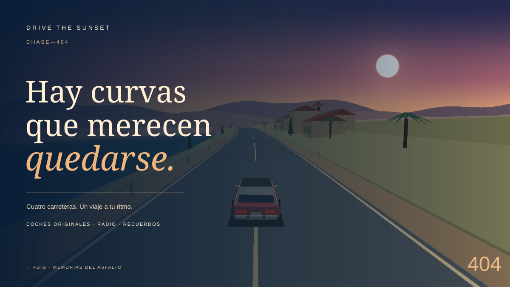

# CHASE-404: DRIVE THE SUNSET



Un juego original de conducción arcade y viajes mediterráneos. Seis carreteras, siete coches americanos ficticios de los años 70, 80 y 90, radio sintetizada y pequeñas historias para descubrir al detenerte.

**Versión: 1.2.0-rc.1.** Candidata de contenido con conducción diferenciada, 18 encuentros, seis rutas y siete vehículos. WebGL es el renderizador exclusivo de conducción; esta ampliación pasó pruebas automatizadas locales. El ajuste humano de los coches y la prueba física de móvil/audio siguen pendientes. Consulta [QA_REPORT.md](QA_REPORT.md).

## Empezar

Extrae todo el ZIP antes de arrancar. El archivo principal es `index.html`; necesita HTTP por sus módulos JavaScript.

**Linux Mint / Linux con Python 3:** abre una terminal en la carpeta y ejecuta:

```bash
bash INICIAR-LINUX.sh
```

**Windows:** abre `INICIAR-WINDOWS.bat`. Intenta Python 3 y, si no está disponible, utiliza el servidor PowerShell incluido. No instala programas ni modifica permanentemente la configuración del sistema. El lanzador de Windows se ha revisado y probado por contrato estático; su ejecución en Windows físico sigue pendiente.

Ambos servidores escuchan únicamente en el equipo local. Mantén abierta la terminal mientras juegas y pulsa Ctrl+C para cerrarlos. Como alternativa, con Python 3:

```bash
python3 -m http.server 8080 --bind 127.0.0.1
```

Abre `http://127.0.0.1:8080/`. Si introduces ese comando desde otra carpeta, debes entrar primero en la del juego. Abrir `index.html` directamente mediante `file://` no es el método de ejecución compatible.

## El viaje

| Carretera | Longitud | Cuatro lugares de parada |
|---|---:|---|
| Costa del Último Sol | 8 km | Salmar, faro, túnel de las Gaviotas, cala de las Cartas |
| Sierra de los Susurros | 7,5 km | Puente del Viento, mirador, túnel de la Sierra, lago |
| Carretera de los Viñedos | 9 km | Masía del Olivo, estación Solana, Alba, molino |
| Carmelo 1984 | 6 km | Plaza de los Tilos, vistas, viaducto, cine Miralba |
| Costa de las Linternas | 7,2 km | Puerto de Lucerna, faro, túnel del cabo, cala de medianoche |
| Paso de los Olivos | 8,2 km | Molinos, casa del aceitero, mirador del viento, aldea |

Los seis recorridos suman 45,9 km. Sus distancias son coordenadas del juego, no mediciones geográficas. **Carmelo es una reinterpretación ficticia de Barcelona**, no una reconstrucción del barrio ni de su trazado histórico.

Hay tres desvíos: costa → sierra, sierra → viñedos y viñedos → Carmelo. Las señales y el atlas muestran la conexión. Al elegir un destino empiezas su recorrido en el km 0, conservas las métricas del viaje y la geometría de carretera se mezcla durante 420 m. No elegir mantiene la ruta actual. También puedes empezar cualquier carretera desde el menú.

Todos los vehículos y escenarios están disponibles desde el principio:

- **Vesper GT 1972:** muscle, aceleración fuerte y dirección más tranquila.
- **Solstice LX 1984:** descapotable, crucero suave.
- **Phantom XR 1987:** coupé, mayor agilidad y velocidad.
- **Meridian S 1992:** sedán, peso visual y manejo propio.
- **Ironclad V8 1970:** muscle clásico ancho, potente y con más inercia.
- **Starlight GT 1988:** deportivo compacto y de dirección rápida.
- **Longhorn LX 1995:** gran turismo estable y progresivo.

El garaje permite seis pinturas, dos acabados de llantas, tráfico configurable, sensibilidad y cuatro ambientes: atardecer, amanecer, noche y lluvia. Elige coche y ruta antes de empezar o abre el garaje durante la conducción.

## Crucero y Arcade

**Crucero** no tiene cronómetro obligatorio, persecuciones, combustible ni game over por conducir despacio. Los contactos reducen la velocidad; no destruyen el vehículo ni terminan el viaje.

**Arcade** añade tres actividades opcionales, sin bloquear ningún contenido:

| Actividad | Condición |
|---|---|
| Viaje limpio | 1 km seguido dentro de la carretera, sin contactos |
| Ruta fluida | 45 segundos seguidos a 45–100 km/h, dentro de la carretera y sin freno de mano |
| Exploración | Recordar tres lugares diferentes durante el viaje en Arcade |

Puedes cambiar la actividad en el garaje. En Crucero su progreso espera. Las métricas del viaje y las historias siguen disponibles. El diario conserva las actividades completadas.

## Controles

| Acción | Teclado |
|---|---|
| Acelerar | W / ↑ |
| Frenar y, manteniendo, marcha atrás | S / ↓ |
| Izquierda / derecha | A / ← · D / → |
| Freno de mano | Espacio |
| Pausa / continuar | P / Esc |
| Reiniciar carretera | R |
| Ayuda / foto | H / F |
| Escuchar un encuentro | E |
| Elegir desvío | 1 / 2 |

La pausa, los menús, la pérdida de foco y una pestaña oculta limpian los controles activos. Al volver de una pestaña oculta, reanuda explícitamente con P o el botón. Las ventanas se cierran con Esc; final e inicio tienen sus propios botones.

Los controles táctiles aparecen en dispositivos con puntero táctil. Hay entrada analógica mediante Gamepad API para mando estándar: stick izquierdo, gatillos y Start. El teclado y el táctil tienen prioridad cuando se usan a la vez; soltar W conserva la aceleración si ↑ sigue pulsada. El botón táctil DER. activa el freno de mano. **Mando físico y dispositivos móviles siguen pendientes de prueba.**

## Recuerdos, radio y fotografías

Las 24 historias son opcionales. Frena a menos de 115 m de una parada y por debajo de 5 km/h para guardar su recuerdo. Los relatos y las postales se consultan en el diario. En el mirador del faro hay además una postal del viaje costero.

Activa **AUDIO** tras empezar. Las tres emisoras contienen piezas originales sintetizadas por el propio juego: *Cartas de verano*, *Luces de Miralba* y *Antes del regreso*. Música, motor y ambiente tienen volúmenes independientes. No hay canciones comerciales, muestras externas ni servicios de streaming. Su funcionamiento se ha inspeccionado y el control de radio se ha probado; la mezcla audible en navegador sigue pendiente de escucha.

## Dieciocho encuentros y veinticuatro despedidas

Cada carretera tiene tres encuentros opcionales. Cuando aparezca el aviso, detente por debajo de 5 km/h a menos de 125 m del punto y pulsa **E / ESCUCHAR**. La conversación pausa el viaje y permite dos decisiones. Puedes cerrarla sin elegir o pasar de largo; las decisiones se guardan en el viaje.

| Ruta | Primer encuentro | Último encuentro |
|---|---:|---:|
| Costa | La carta azul · km 0,62 | La llamada · km 7,18 |
| Sierra | El mapa · km 0,64 | La segunda silla · km 6,85 |
| Viñedos | Pan para Alba · km 0,57 | La mesa · km 8,17 |
| Carmelo | Dos entradas · km 0,46 | El cine · km 5,45 |
| Costa de las Linternas | La caja del puerto · km 0,56 | Luces en la cala · km 6,76 |
| Paso de los Olivos | El perro del olivar · km 0,70 | La mesa de la plaza · km 7,78 |

Cada ruta tiene cuatro despedidas: sin encuentro final, cumplir el encargo, compartir el momento sin encargo, o seguir hacia casa. Se descubren al alcanzar el final de la carretera y quedan en el diario. Repetir una ruta permite elegir de nuevo. Cambiar de carretera por un desvío conserva decisiones del viaje, pero solo registra la despedida de la carretera terminada.

La resolución de escenas y recorridos se ha probado con automatización; no es una afirmación sobre horas de juego humano.

**FOTO** pausa la simulación y oculta el HUD. «Guardar foto» descarga un PNG de la escena WebGL.

## Datos y copias

Todo se guarda en el almacenamiento local del navegador: ajustes, partida en curso, recuerdos, postal y registros de actividades. No se envían datos, no hay cuentas ni analítica. Cambiar de navegador, origen o puerto crea un espacio de almacenamiento distinto. El lanzador reutiliza el puerto 8765 siempre que esté libre, para conservar el origen entre sesiones; si está ocupado intenta 8766–8775. Usa la copia JSON para trasladar tu progreso entre orígenes o equipos.

El diario permite **descargar una copia JSON**, **restaurarla** y **descargar la copia anterior a la última restauración**. La importación valida versión, tamaño y contenido; hace una copia previa y revierte los datos si falla una escritura. El límite de importación es 512 KB.

Las copias nuevas son formato 2 para evitar que clientes antiguos descarten los nuevos finales. Se aceptan copias formato 1 y 2. No restaures una copia nueva con una versión antigua del juego.

Los guardados v1 anteriores se siguen leyendo y se escriben como v2. No se borran las claves originales para realizar la migración. Si el navegador bloquea el almacenamiento, el juego avisa y permite exportar el estado en memoria. No promete un guardado que haya fallado.

## Gráficos y accesibilidad

La carretera se dibuja únicamente con **WebGL**: geometría 3D original, luz, faros, fachadas, terreno, tráfico y tres cámaras. El minimapa y la exportación PNG usan Canvas 2D como utilidades de interfaz; no son un modo alternativo de conducción. Si WebGL no está disponible, el juego informa del requisito y bloquea el inicio en lugar de cambiar a otra presentación.

No requieren frameworks, CDN, fuentes descargadas ni archivos de modelos externos. La calidad «Ahorro» reduce detalle y resolución. «Automático» adapta la resolución interna tras 90 muestras lentas y la recupera de forma gradual; el HUD conserva su resolución. El terreno y los edificios se reutilizan entre tramos de 24 m. Los valores medidos pertenecen al equipo de prueba, no son FPS universales. Movimiento reducido, contraste y texto grande son independientes del clima; la preferencia del sistema para movimiento reducido se usa por defecto cuando aún no hay ajustes.

La geometría del proyecto anterior se revisó mediante Mesa GLES por software. Esta RC1 amplía geometría y shader; sus nuevas escenas todavía no se han comprobado mediante WebGL real. Eso **no** equivale a una prueba de WebGL en todos los navegadores ni de una GPU física. Carmelo cambia entre plaza, ladera abierta, talleres y cine; las rutas nuevas usan puerto y olivares como referencias visuales. La luz progresiva del atardecer se puede desactivar en el garaje.

## GitHub Pages

Esta carpeta está preparada para servirse como sitio estático desde la raíz del repositorio, incluso bajo una subruta como `/CHASE-404/`. `index.html` debe quedar en la raíz publicada junto con `js/`, `webgl/`, `assets/` y `style.css`.

En un repositorio habilitado para Pages, selecciona la rama que contenga estos archivos y la carpeta `/ (root)`. Mantén `.nojekyll`. `package-smoke` comprobó la estructura y las rutas relativas previstas para una subruta. El HTTP real bajo subruta quedó bloqueado en este entorno y esta RC1 **no se ha publicado**; la RC4 anterior sigue en la página existente.

No hay Service Worker ni instalación PWA. Una vez descargado el proyecto, el servidor local funciona sin Internet. «Sin conexión» no significa que una página alojada se pueda recargar offline sin haber descargado antes los archivos.

## Verificación para desarrollo

Para jugar no hace falta Node ni instalar paquetes. Para comprobar la lógica y reproducir el bundle opcional se usa Node.js 20 o posterior y Python 3:

```bash
node tools/build.mjs
bash QA_RUN.sh
```

La entrada del juego usa módulos nativos, no el bundle. El builder mantiene ámbitos separados y comprueba un espejo clásico reproducible; nunca concatenes los módulos retirando sus imports.

El smoke de runtime usa un renderizador WebGL simulado para validar DOM, controles y progresión; no comprueba una GPU. El test de navegador opcional necesita Playwright y un Chromium operativo: define `CHASE_BROWSER_BINARY` antes del runner. Ninguna de esas dependencias se carga en el juego.

El replay GLES se reproduce en Linux con EGL/GLES de Mesa y Pillow:

```bash
node tools/capture-gles.mjs
python3 tools/gles-smoke.py
```

Hay un modo de diagnóstico local `?qa=1` para los scripts de pruebas. No está habilitado en el uso normal; sus saltos de posición no forman parte del juego ni acreditan una sesión jugada.

## Licencia y alcance

MIT, conservada desde el proyecto original. Código, geometría, interfaces, relatos y composición musical generativa son originales de este proyecto. Los coches y negocios usan nombres ficticios. El arte vectorial del portal incluye una imagen del propio renderizador, sin recursos de terceros.

Se ha conservado el núcleo útil; se han retirado la demo separada, el comparador antiguo y los informes de versiones anteriores del paquete de distribución. El ZIP original no se ha modificado. Consulta [CHANGELOG.md](CHANGELOG.md), [PLAN.md](PLAN.md) y [QA_REPORT.md](QA_REPORT.md) para las decisiones y su evidencia.
